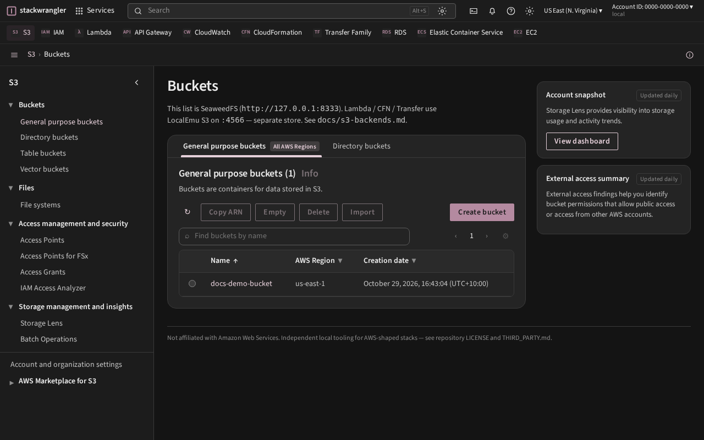
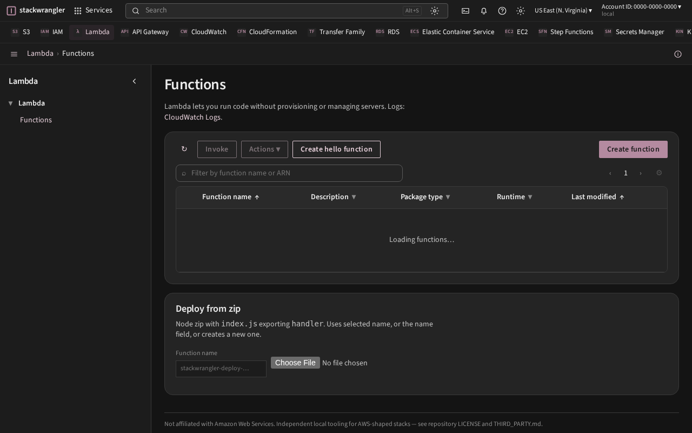
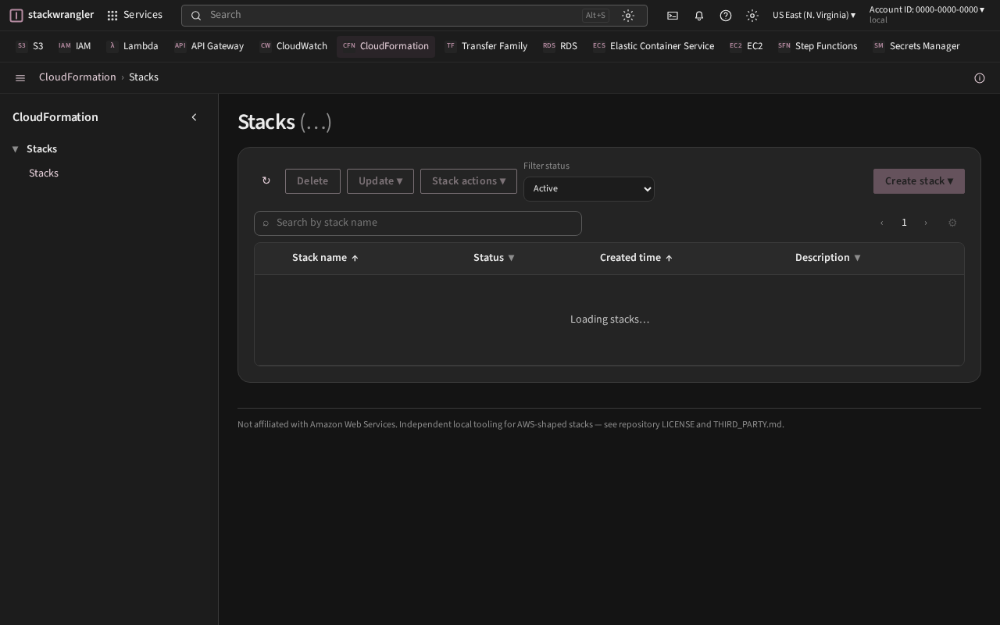

# stackwrangler

**Not affiliated with Amazon Web Services.** Independent open-source tooling to develop and test AWS-shaped stacks locally, then deploy to real AWS. Not an AWS product and not a hosted substitute for AWS.

One **local AWS-shaped account** — real APIs, a grey-rose console on localhost, and IaC against profile `local`. Learn and stage without a cloud bill. Authz that **denies** when the policy is wrong — not a silent green.

North star: [docs/vision.md](docs/vision.md) · Docs: [docs-site/](docs-site/) → [kgz.github.io/stackwrangler](https://kgz.github.io/stackwrangler/) · Status: [docs/status.md](docs/status.md) · [LICENSE](LICENSE) (MIT) · [THIRD_PARTY.md](THIRD_PARTY.md)

## Console

Live local console (grey rose chrome) — same account as CLI and IaC.







## Features

- **One local account** — CLI (`aws --profile local`), console, and Terraform / CDK / SAM / Serverless hit the same endpoints
- **Fully working bar** — create → configure → traffic or data moves → you can see it. Control-plane stubs stay labelled stubs (no catalogue theatre)
- **Authz that denies** — LocalEmu with `IAM_ENFORCEMENT=1`; workload principals and resource policies fail like AWS when the policy is wrong
- **Honest depth** — Working / Partial / Sidecar / Backlog are first-class; see [docs/status.md](docs/status.md)
- **Local → real AWS** — stage here, then point the same tooling at a real account

Built on **LocalEmu** (not LocalStack Community — we need IAM enforcement) plus sidecars: **SeaweedFS** (console buckets), **distribution/registry** (ECR-shaped push/pull), **atmoz/sftp** (Transfer dataplane). Console buckets UI uses SeaweedFS; IaC / Lambda / S3 events use **LocalEmu S3** ([docs/s3-backends.md](docs/s3-backends.md)).

## Install (Docker only — no git)

**This is the primary public path.** Requires Docker Engine (Compose v2). Full detail: [docs/docker-install.md](docs/docker-install.md).

```bash
mkdir -p ~/.stackwrangler ~/.aws
docker pull ghcr.io/kgz/stackwrangler:latest
docker run --rm --network host \
  -v /var/run/docker.sock:/var/run/docker.sock \
  -v "$HOME/.stackwrangler:/data" \
  -v "$HOME/.aws:/root/.aws" \
  ghcr.io/kgz/stackwrangler:latest up
```

That `up` starts APIs **and** the console web app. Open <http://127.0.0.1:3000>, then:

```bash
aws --profile local s3 ls
aws --profile local --endpoint-url http://127.0.0.1:4566 sts get-caller-identity
```

Upgrade / teardown / ports / known limits (host Docker, sock mounts, dual S3): [docs/docker-install.md](docs/docker-install.md).

Optional thin CLI (GitHub Release asset `stackwrangler`): same `up` / `down` / `status` commands without typing `docker run`.

Contributor clone path: `./bin/stackwrangler up` copies `.env.example` → `.env` on first run. Defaults: access key `stackwrangler`, secret `stackwranglerstackwrangler`, profile `local`. Tear down with `./bin/stackwrangler down` (add `--remove-profile` to drop the profile).

| What | Where |
|------|--------|
| S3 (console buckets) | `http://127.0.0.1:8333` SeaweedFS |
| LocalEmu (IAM, Lambda, CFN, Transfer, RDS, …) | `http://127.0.0.1:4566` |
| Transfer SFTP (native) | `127.0.0.1:2222` ([docs/transfer.md](docs/transfer.md)) |
| Console | `http://127.0.0.1:3000` |
| Profile | `local` |
| Config / data | `~/.stackwrangler` |

Images publish to GHCR on product tags (`vX.Y.Z`). Until a tag has been cut, build locally from a contributor checkout with `./bin/build-release-images.sh` (see docker-install docs) — **running** the stack still does not require keeping the clone.

## Contributors (git clone)

For patches, smokes, OpenSpec, and Open Design — not required to run or upgrade the public image path:

```bash
git clone https://github.com/kgz/stackwrangler.git
cd stackwrangler
./bin/stackwrangler up
./bin/stackwrangler console   # Vite dev server on :3000
```

See [CONTRIBUTING.md](CONTRIBUTING.md). Coming from older checkouts named `awsbox`: `./bin/awsbox` still shims to `stackwrangler`.

## Documentation

- [Docker install](docs/docker-install.md) — public path (start here)
- Public docs site: [docs-site/](docs-site/) (VitePress) → [kgz.github.io/stackwrangler](https://kgz.github.io/stackwrangler/) after Pages is enabled on a public repo
- Run docs locally: `cd docs-site && pnpm install && pnpm dev`
- [Vision](docs/vision.md) — north star (mirrored on the site)
- [Service status](docs/status.md) — Working / Partial matrix
- [Contributing](CONTRIBUTING.md)

## License

[MIT](LICENSE) · third-party notices: [THIRD_PARTY.md](THIRD_PARTY.md)
