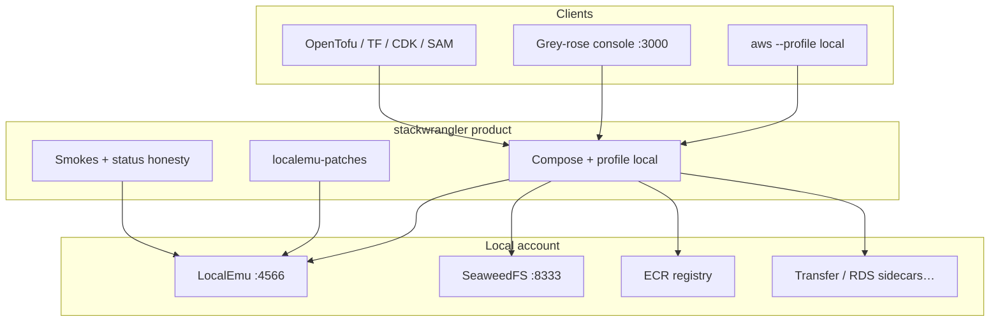

# Architecture

stackwrangler is not a second AWS emulator. It is a **hardened, opinionated assembly** around LocalEmu: defaults that deny bad IAM, patches for org-path gaps, real sidecars when the emulator cannot move bytes, plus profile `local`, console, and smokes.

**#1 product choice:** most local stacks **default-allow** IAM. We run **`IAM_ENFORCEMENT=1`** so wrong policies **AccessDenied** on the laptop. See [Why](./why) and [Compare](./compare/).

## Layers

| Layer | What | Why |
|-------|------|-----|
| **LocalEmu** | AWS APIs on `:4566` | Free engine with real Docker Lambda / EC2-shaped paths when configured |
| **Opinionated defaults** | `IAM_ENFORCEMENT=1`, Docker RDS, … | Not default-allow; fewer silent greens |
| **`localemu-patches/`** | VPC/SG, Transfer SFTP, resource policies, … | Close fidelity gaps LocalEmu alone leaves open |
| **Sidecars** | SeaweedFS, distribution/registry, Postgres/MySQL, … | Real bytes when the emulator cannot deliver a data plane |
| **Console + profile** | `:3000`, `aws --profile local` | One account for humans and IaC |
| **Smokes / Completeness** | Working / Partial / Sidecar / Stub | Prove claims; refuse catalogue theatre |

## Why this is more consistent than a single mock

A monolithic mock returns JSON shaped like AWS. Cross-service and storage behaviour often lies under load.

We keep the API surface on LocalEmu (and moto inside it for many backends), then:

- **Enforce authz** in-process (`IAM_ENFORCEMENT=1`)
- **Patch** awkward networking / Transfer / policy edges in `localemu-patches/`
- **Run real engines** in sidecars for storage, registry, DB, SFTP when needed
- **Label** what is still Partial or Stub on [Completeness](./completeness)

That is why an OpenTofu path with IAM + VPC + messaging behaves more like the org account you will deploy to — and why we disagree with “emulators are never enough for enterprise IAM/VPC.” The bar is **account behaviour we smoke**, not a commercial badge.

## Dual S3 (intentional)

Console / `profile local` S3 → SeaweedFS `:8333`.  
IaC / Lambda / events / IAM labs → LocalEmu S3 `:4566`.

Documented split — [Concepts](./concepts), [Dual S3](./interactions/dual-s3). Not a hidden bug.

## Related

- [Concepts](./concepts) — short glossary  
- [Fidelity](./fidelity) — awkward topology / settings bar  
- [Compare](./compare/) — vs LocalEmu, LocalStack, Moto, …  
- [Vision](./vision) — north star  

Not affiliated with Amazon Web Services.
