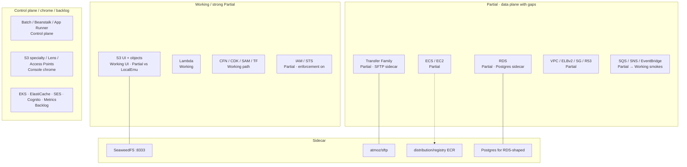

# Completeness / status

Honest depth across the hosting footprint. Pulled from the [README status matrix](https://github.com/kgz/stackwrangler/blob/main/README.md) and [`docs/version-plan.md`](https://github.com/kgz/stackwrangler/blob/main/docs/version-plan.md). Stubs are stubs — we do not pretend they are shipped.

## Legend

| Tag | Meaning |
|-----|---------|
| **Working** | Data plane + CLI smoke + console for the happy path |
| **Partial** | Works with known gaps (dual backends, bridge, limited authz) |
| **Control plane** | `create-*` / `describe-*` OK; little/no real traffic |
| **Sidecar** | Real bytes via a stackwrangler container, not native service listen |
| **Backlog** | Ticketed, not started |
| **Console chrome** | Nav / empty page only |

## Hosting footprint (overview)

## Platform

| Area | Status |
|------|--------|
| `./bin/stackwrangler up` + profile `local` | **Working** |
| Console shell (grey rose) | **Working** |
| Dual S3 (SeaweedFS + LocalEmu) | **Documented split** · Partial until unify |
| IAM enforcement | **Partial** |

## Storage & objects

| Service | Status |
|---------|--------|
| S3 general purpose | **Working** (UI) · **Partial** (vs LocalEmu for events) |
| S3 specialty / Access Points / Lens | **Console chrome** |
| Transfer Family | **Partial** · **Sidecar** SFTP |
| EFS / FSx / EBS | **Backlog** |

## Compute & containers

| Service | Status |
|---------|--------|
| Lambda | **Working** (authz depth ongoing) |
| EC2 / ECS | **Partial** |
| ECR | **Partial** · registry sidecar |
| Batch / Beanstalk / App Runner | **Control plane** |
| EKS | **Backlog** |

## Networking, data, messaging, security

| Domain | Typical depth |
|--------|----------------|
| VPC / SG / ELBv2 / private R53 | **Partial** with smokes |
| RDS / Aurora-shaped | **Partial** · DB sidecar |
| DynamoDB / SQS / SNS / EventBridge / SFN / Kinesis | Smokes present · treat as **Partial→Working** per README |
| KMS / Secrets / ACM / WAFv2 | Mixed · see README |
| CloudFront / Cognito / Metrics / SES / ElastiCache | **Backlog** or thin |

## Architecture map (experimental)

Coming with [#389](https://github.com/kgz/stackwrangler/issues/389): an experimental console canvas that draws a live one-account platform topology (NLB/ALB → edge → Lambda/S3/ECS → RDS, plus honesty edges such as surprise IAM Allows). Seed scripts and design notes land with that change — they are **not** on `main` yet.

A product screenshot belongs here once that page ships — we do **not** use AWS console recon images as stand-ins.

## Version cuts

Product cuts (`v0.0.2`, `v0.0.3`, `v0.1.0` org path, …) are planned in [`docs/version-plan.md`](https://github.com/kgz/stackwrangler/blob/main/docs/version-plan.md). Catalogue milestones are orthogonal to depth: **execution order follows data-plane value**, not milestone number.
