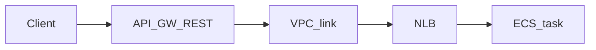

# API Gateway REST → VPC link → NLB → ECS

HTTP API is not this path. REST API integrates via VPC link to an NLB; targets are ECS (awsvpc ENI in subnet). Authz: no token / Deny; unhealthy target → 5xx.

**Status:** partial · Gaps: Deny status codes [#190](https://github.com/kgz/stackwrangler/issues/190)

## Sequence



1. Provision VPC, NLB, ECS service, VPC link, REST API integration.
2. Call the stage URL; backend receives traffic.
3. Sad: missing/deny auth; unhealthy target.

## Prove it

```bash
./bin/apigw-nlb-ecs-smoke.sh
```
