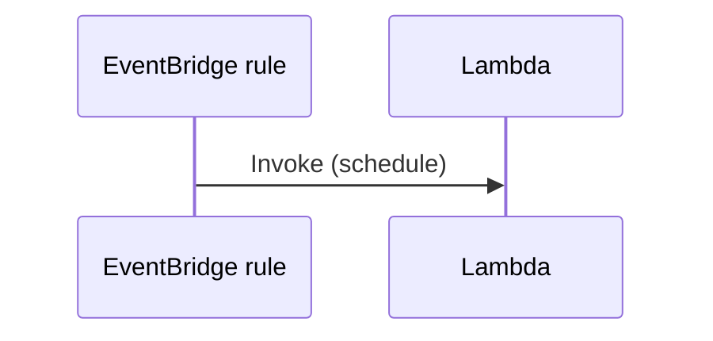

# EventBridge schedule → Lambda

A scheduled rule (`rate(1 minute)`) invokes a Lambda target. Disable the rule → invocations stop. Rule without `lambda:InvokeFunction` for `events.amazonaws.com` never invokes.

**Status:** shipped

## Sequence



1. Create function + rule with Lambda target and correct permission.
2. Wait for ≥2 invocations on a one-minute rate.
3. Disable rule; confirm quiet.
4. Sad: permission missing → no invokes.

## Prove it

```bash
./smokes/messaging/events-schedule-smoke.sh
```
