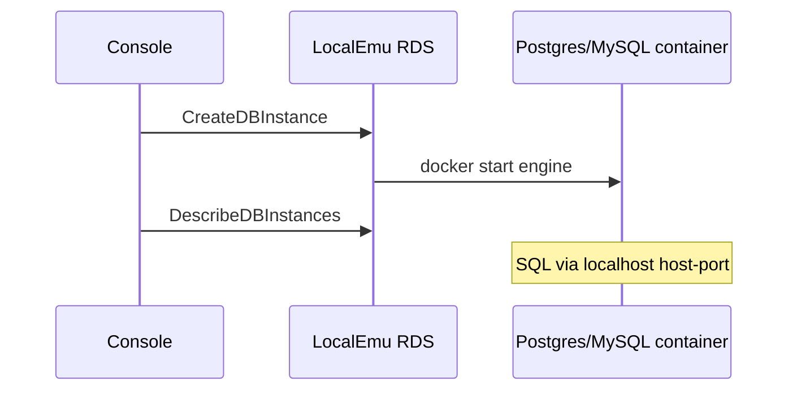

# RDS Create database → SQL

Console **Create database** (`/rds/create`) calls `CreateDBInstance` for Postgres or MySQL. With `RDS_DOCKER_BACKEND=1`, LocalEmu starts a real engine container; `psql` / `mysql` reach it on the published host port.

**Status:** shipped

## Sequence



1. Open `/rds/create` (or CLI `create-db-instance`).
2. Choose Postgres or MySQL; submit.
3. List/detail under `/rds`; connect with `psql` / `mysql` using the endpoint + master password.
4. Aurora cluster create stays CLI-only (`./smokes/data/rds-mysql-smoke.sh`); console Aurora tile is disabled.

## Prove it

```bash
./smokes/data/rds-smoke.sh
./smokes/data/rds-mysql-smoke.sh
# console Create path
cd console && yarn playwright test e2e/rds-create.spec.ts
```

Matrix: [smoke-matrix](https://github.com/kgz/stackwrangler/blob/main/docs/smoke-matrix.md) · RDS · [rds.md](https://github.com/kgz/stackwrangler/blob/main/docs/rds.md).

UI shot: [rds-databases](/assets/console/rds-databases.png).
