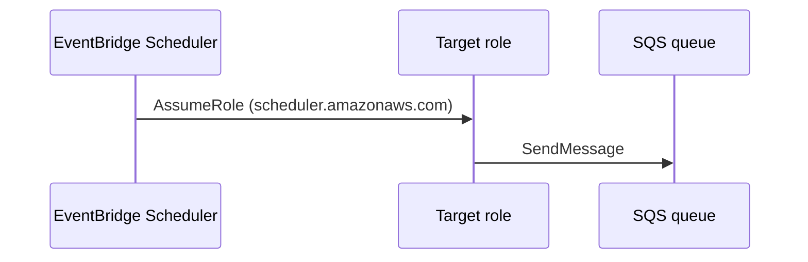

# EventBridge Scheduler → SQS

Create a schedule group and a one-off `at(...)` schedule whose target is an SQS queue. When the time fires, Scheduler assumes the target role as `scheduler.amazonaws.com` and the message arrives on the queue.

**Status:** shipped (happy path). IAM resource ARN shape and SourceArn trust conditions: [#663](https://github.com/kgz/awsl/issues/663), [#665](https://github.com/kgz/awsl/issues/665).

## Sequence



1. Enable `scheduler` in compose `SERVICES` (local stack).
2. Create queue + role trusted by `scheduler.amazonaws.com` with `sqs:SendMessage`.
3. Create schedule group + `at(...)` schedule targeting the queue.
4. Receive the probe message on the queue.

## Prove it

```bash
./smokes/messaging/scheduler-smoke.sh
```
