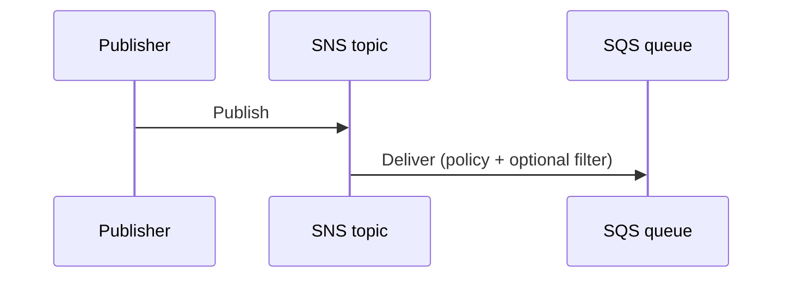

# SNS → SQS fan-out

Publish to an SNS topic; subscribed SQS queues receive the message (envelope, raw delivery, filter policies; CMK with SNS grant).

**Status:** shipped

## Sequence



1. Create topic + queue; attach queue policy allowing SNS.
2. Subscribe queue to topic (raw or standard envelope).
3. Publish; receive on the queue.
4. Sad paths: wrong/missing queue policy; CMK without SNS grant; unsubscribe.

## Prove it

```bash
./bin/sns-sqs-fanout-smoke.sh
```

Matrix: [smoke-matrix](https://github.com/kgz/stackwrangler/blob/main/docs/smoke-matrix.md) · SNS → SQS fan-out.
