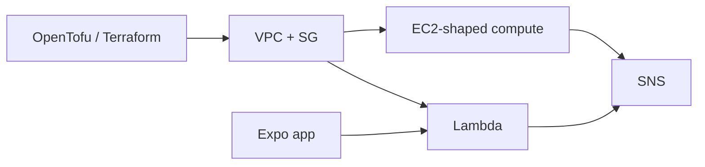

# Use case: OpenTofu → VPC → Lambda / EC2 → SNS → Expo

Stage a hosting-shaped stack locally: **OpenTofu / Terraform** applies into profile `local`, workloads run under **strict IAM** and **Secrets Manager**, messaging hits **SNS**, and an **Expo** client talks to local APIs — before the same shape goes to real AWS.

## Who this is for

Teams building B2B / CRM-style backends with a mobile client who need IAM and networking mistakes to fail **on the laptop**, not in a shared cloud account.

## Why stackwrangler for this path

**Default-allow IAM will lie to you on this path.** A missing `sns:Publish` or bad task role still “works” on many local stacks until Expo hits real AWS. We run **`IAM_ENFORCEMENT=1`** so those calls **AccessDenied** locally.

Same free-emulator job underneath — then harden VPC/SG, console, sidecars, and smoke the deny paths.

| Need | Why raw LocalEmu / Moto often under-deliver |
|------|-----------------------------------------------|
| IAM + secrets | Default-allow vs enforcement + deny smokes on by product default |
| SG / VPC behaviour | API theatre vs patched packet paths |
| One account for TF + mobile + console | Profile `local` + grey-rose console |
| Honest limits | Working / Partial / Stub — see [Completeness](../completeness) |

Compare: [vs LocalEmu](../compare/vs-localemu) · [vs Moto](../compare/vs-moto).

## What “strict IAM + ASM” means here

- `IAM_ENFORCEMENT=1` on the LocalEmu engine
- Workload principals and resource policies can **AccessDenied**
- Secrets Manager for runtime secrets (see [Lambda → Secrets → HTTP](../interactions/lambda-secrets-http))
- Prove deny: [IAM deny](../interactions/iam-deny) · repo smoke `./smokes/security/iam-access-denied.sh`

## Expo networking

Host ports publish to **`127.0.0.1`** by default (laptop safety).

| Client | Typical reach |
|--------|----------------|
| iOS Simulator | Shares the host — `http://127.0.0.1:4566` (or your API port) often works |
| Android Emulator | Host loopback as `http://10.0.2.2:4566` |
| Physical phone (Expo Go on Wi‑Fi) | Phone’s `127.0.0.1` is the phone — bind publish to the LAN / `0.0.0.0` or use a tunnel; do not treat loopback as “prefer a thinner emulator” |

Linux-first: ports bind on the Docker host. Adjust compose publish only when a physical device must reach the laptop.

## Scanners

| Tool | Status on this stack |
|------|----------------------|
| **Prowler** | Scoped posture scan supported — [prowler.md](https://github.com/kgz/stackwrangler/blob/main/docs/prowler.md), `./smokes/security/prowler-smoke.sh`. Not full-catalog parity. |
| **Parliament** | No dedicated in-repo surface yet. IAM JSON you deploy locally is still lintable with policy tools; do not claim stackwrangler-specific Parliament integration. |

## Quick start

1. [Getting Started](../getting-started) — `up`, profile `local`, console `:3000`
2. Point OpenTofu / Terraform at the local endpoints (profile `local` / `AWS_ENDPOINT_URL` as your provider docs require)
3. Exercise IAM deny and a messaging path before wiring Expo
4. Later: same shape → real AWS credentials

## Honesty

- EC2 here is **container-backed**, not a full VM
- Dual S3 (console SeaweedFS vs LocalEmu IaC) — [Dual S3](../interactions/dual-s3)
- “Parity-checked” means paths we smoke / parity-test — not every AWS knob

Not affiliated with Amazon Web Services.

Next: [Use cases](./) · [Compare](../compare/) · [Why](../why)
