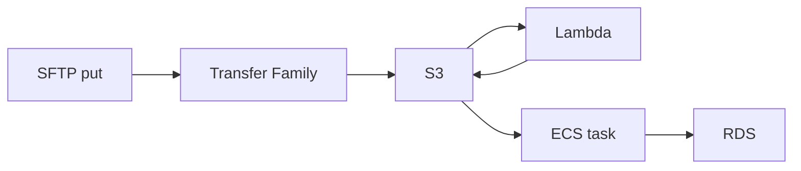

# Use case: Org path (Transfer → … → RDS)

Learning / staging path for **v0.1.0**: ingest a file over SFTP, process it under IAM, land it in S3, run an ECS task, write a row to RDS — all against profile `local` after `./bin/stackwrangler up`.



**Status today: partial.** Individual hops are smoked. The stranger-facing Terraform example and one E2E script are **coming in the cut** ([#780](https://github.com/kgz/stackwrangler/issues/780), [#781](https://github.com/kgz/stackwrangler/issues/781)). Do not treat the full chain as Working until that smoke exits 0.

Repo detail (real vs stub table, Dual S3): [docs/org-path.md](https://github.com/kgz/stackwrangler/blob/main/docs/org-path.md) · ship bar: [version-plan](https://github.com/kgz/stackwrangler/blob/main/docs/version-plan.md).

## Who this is for

Teams whose production shape is **SFTP ingest → serverless/process → object store → container job → relational DB**, who need authz and store mistakes to fail on the laptop before a shared cloud account.

## Host / ports (Linux-first)

| What | Address |
|------|---------|
| LocalEmu APIs | `http://127.0.0.1:4566` |
| Console / profile `local` S3 (SeaweedFS) | `http://127.0.0.1:8333` |
| Transfer SFTP | `127.0.0.1:2222` |
| Console | `http://127.0.0.1:3000` |

Ports bind on the Docker host. Windows: use Linux via WSL — see [Getting Started](../getting-started).

## Real vs stub (short)

| Hop | Depth |
|-----|--------|
| Transfer SFTP → object | **Partial** — native SSH-key SFTP → LocalEmu S3 |
| Lambda | **Working** invoke; path wiring hop-smoked |
| S3 | **Partial** — dual brain today (see below) |
| ECS / ECR | **Partial** |
| RDS SQL | **Partial** · Docker sidecar |

Full table + gap tickets: [org-path.md](https://github.com/kgz/stackwrangler/blob/main/docs/org-path.md). Hop catalog: [Transfer SFTP → S3](../interactions/transfer-sftp-s3) · [Dual S3](../interactions/dual-s3) · [ECS → ECR](../interactions/ecs-ecr-pull) · [RDS → SQL](../interactions/rds-create-sql).

## Dual S3 (blocks an honest ship bar)

Console and `aws --profile local` list **SeaweedFS** (`:8333`). Transfer / Lambda / IaC use **LocalEmu S3** (`:4566`). An SFTP put can “succeed” while the console bucket view stays empty.

**v0.1.0** requires one brain for the path **or** a non-silent switch — [#162](https://github.com/kgz/stackwrangler/issues/162). Until then, assert the store the docs name.

```bash
./smokes/s3/s3-dual-endpoint-smoke.sh
```

## Prove hops today

```bash
./bin/stackwrangler up

./smokes/transfer/transfer-key-smoke.sh
./smokes/transfer/transfer-dataplane-smoke.sh
./smokes/lambda/lambda-smoke.sh
./smokes/compute/ecr-smoke.sh
./smokes/data/rds-smoke.sh
```

Full-chain E2E: when merged, follow [#781](https://github.com/kgz/stackwrangler/issues/781) and the example README from [#780](https://github.com/kgz/stackwrangler/issues/780). Status matrix: [Completeness](../completeness) · repo [status.md](https://github.com/kgz/stackwrangler/blob/main/docs/status.md).

## Why stackwrangler here

**Default-allow IAM lies on this path.** A Transfer role without `s3:PutObject`, or an ECS task role without DB rights, still “works” on many local stacks until production. We run **`IAM_ENFORCEMENT=1`**. Compare: [vs LocalEmu](../compare/vs-localemu) · [vs Moto](../compare/vs-moto).
